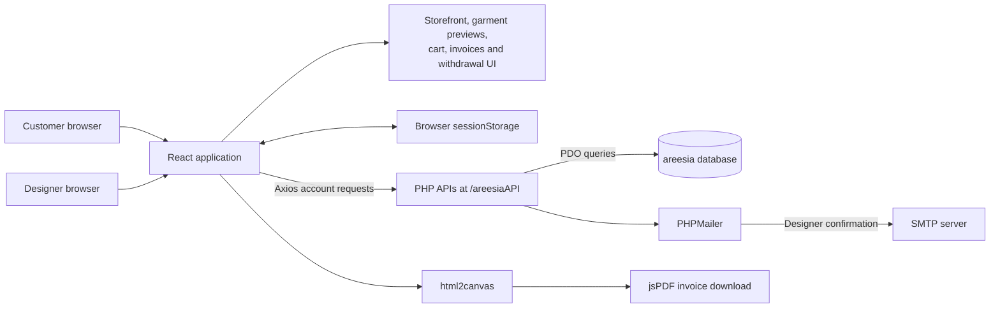
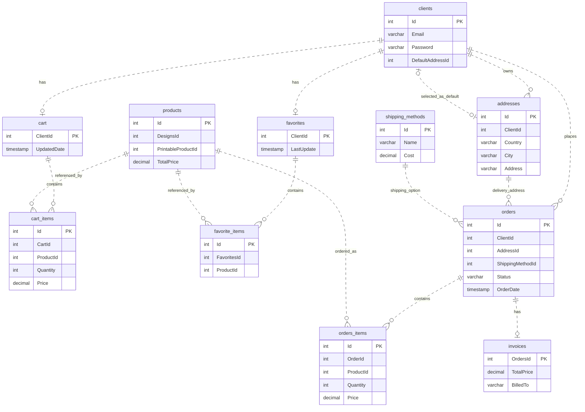
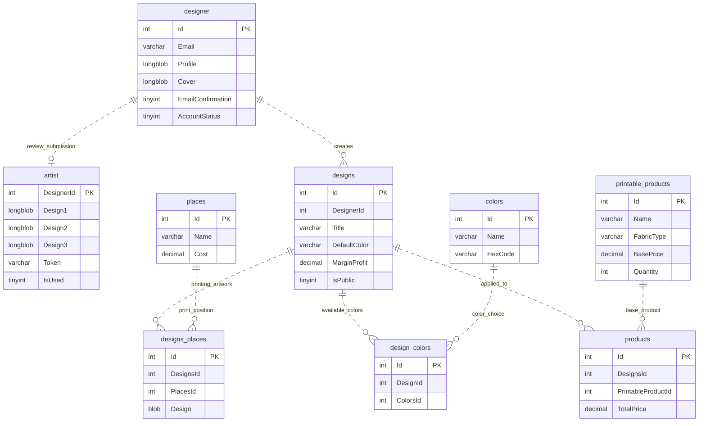
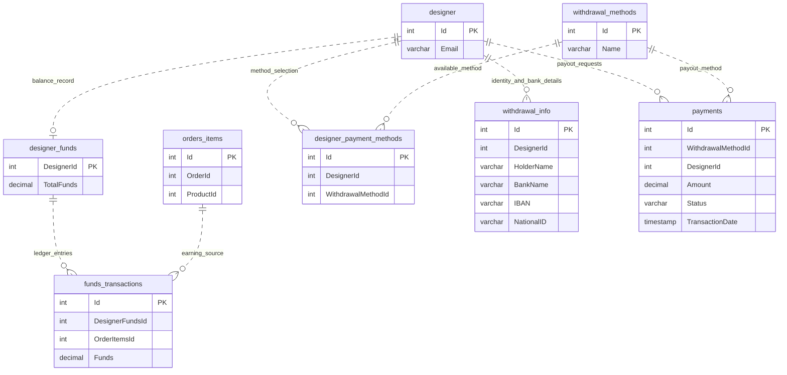

# Areesia — Print-on-Demand Marketplace


A marketplace prototype where customers browse artwork-based products and designers manage their accounts, preview garment artwork, and explore withdrawal interfaces. The project combines a React frontend, PHP account APIs, and a 25-table MySQL/MariaDB database blueprint.

**Project status:** account registration, login, settings, addresses, and designer image uploads have PHP implementations. Much of the storefront, design management, checkout, order history, and withdrawals uses static data or interface-only controls. The supplied schema does not imply that those workflows have backend integration.

## Contents

- [Features and implementation status](#features-and-implementation-status)
- [Technology stack](#technology-stack)
- [Architecture](#architecture)
- [Database diagrams](#database-diagrams)
- [Local setup](#local-setup)
- [Routes and API files](#routes-and-api-files)
- [Project structure](#project-structure)
- [Existing limitations](#existing-limitations)

## Features and implementation status

| Area | Supplied implementation |
| --- | --- |
| Customer accounts | Registration, login, encrypted browser-session data, personal-information updates, password changes, and address creation/editing with default-address selection. |
| Designer accounts | Signup, confirmation email, artwork-review submission, login, personal-information updates, password changes, and profile/cover image uploads. |
| Public storefront | Homepage, categories, gender sections, sample product listing, image-gallery product page, and static public designer profiles. |
| Garment editor | Four-step interface for printing positions, title/description, audience/colors/margin, and visibility/agreement. Five popups preview local artwork. |
| Designer dashboard | Hardcoded order summaries and a sample design-management grid. |
| Cart and orders | Bounded quantity controls, two-step checkout interface, sample order history, static invoices, and client-side PDF export. |
| Withdrawals | Bank Transfer, Cash Plus, WafaCash, payment-request popups, and a sample request-history table. Saving methods and processing payouts are unfinished. |

## Technology stack

| Layer | Technology |
| --- | --- |
| Frontend | React `^18.2.0`, React Router `^6.6.2`, Create React App / `react-scripts` `^5.0.1` |
| UI | Material UI, MUI Joy/Base/Data Grid, Bootstrap `^5.2.3`, styled-components |
| HTTP and browser data | Axios; CryptoJS AES with an environment-supplied key and browser `sessionStorage` |
| Backend | PHP endpoint files, PDO MySQL, bcrypt password hashing |
| Database | MySQL/MariaDB SQL dump; 25 tables using MyISAM |
| Email | Bundled PHPMailer **6.7.1**, configured for SMTP |
| Invoice export | html2canvas `^1.4.1` and jsPDF `^2.5.1` |

Frontend ranges above come from [package.json](frontend/package.json). [package-lock.json](frontend/package-lock.json) records the supplied dependency tree.

## Architecture



The PHP APIs serve account-related workflows. Product listings, order records, balances, and several other screens currently render sample data directly in React. Artwork preview popups use local object URLs; their save controls do not upload designs to a server.

## Database diagrams

The authoritative schema is [database/areesia.sql](database/areesia.sql). The three diagrams below cover **all 25 tables**, with selected columns shown for readability. Some tables appear in more than one diagram to connect the domains.

**Relationship notation:** connections are logical relationships inferred from column names and account helper code, rather than database-enforced foreign keys. The dump declares MyISAM tables, primary/unique keys, and indexes, but **no foreign-key constraints**. `PK` labels identify actual primary keys; dotted connectors show inferred relationships and intended cardinalities.

### 1. Customers, shopping, and orders



`cart` and `favorites` use `ClientId` as their primary key. Consequently, `cart_items.CartId` and `favorite_items.FavoritesId` are inferred to refer to those client-keyed containers; neither parent table defines an `Id` column. `clients.DefaultAddressId` selects an address and has a unique index in the supplied dump. Actual account ownership and referential integrity must not be assumed from these diagrams alone.

### 2. Designers, artwork, and product catalog



The `artist` table stores the three review-submission files and verification token. Profile and cover images are stored as BLOBs on `designer`; image-serving PHP files return those bytes. A catalog `product` conceptually combines a design with a printable base product. `designs.DefaultColor` is a text field, not a declared reference to `colors`.

### 3. Designer funds and payout blueprint



`funds_transactions.DesignerFundsId` is inferred to map to `designer_funds.DesignerId`, because the balance table has no `Id` column. Here, `payments` describes designer payout records, rather than an implemented customer-payment gateway. These tables are a schema blueprint: the supplied withdrawal interfaces do not persist requests, deduct balances, or transfer money.

## Local setup

### Prerequisites

- Node.js and npm for the supplied Create React App dependency tree.
- PHP with the PDO MySQL driver, plus a PHP-capable web server such as Apache/XAMPP.
- A local MySQL/MariaDB instance.
- SMTP configuration if you want to exercise designer confirmation emails.

The project contains a legacy dependency tree. A working frontend build and PHP runtime have not been verified in the documentation environment.

### 1. Clone the repository

```bash
git clone https://github.com/iiMedR/Areesia-Full-Stack-POD-Marketplace-React-PHP.git
cd Areesia-Full-Stack-POD-Marketplace-React-PHP
```

### 2. Import the database

Create a dedicated empty database named `areesia`, then import [database/areesia.sql](database/areesia.sql), for example through phpMyAdmin. The dump contains `DROP TABLE IF EXISTS` statements, so importing it into an existing database replaces the named tables. It defines the schema without seed inserts.

Configure your local connection in [backend/DbConnect.php](backend/DbConnect.php). The supplied defaults are host `localhost`, database `areesia`, username `root`, and an empty password. They are local-development defaults.

### 3. Serve the PHP backend at the expected path

The frontend calls URLs such as:

```text
http://localhost:80/areesiaAPI/signup.php
```

Expose the contents of `backend/` as an `areesiaAPI/` directory in your PHP web server's document root. With XAMPP, that can be a local copy at `htdocs/areesiaAPI/`, including `VerifyEmail/vendor/`. Restart/reload your server as needed and keep that copy synchronized with backend changes.

If you use another host or port, configure both:

- [frontend/src/components/BaseURL.js](frontend/src/components/BaseURL.js): frontend API origin.
- [backend/BaseURL.php](backend/BaseURL.php): origin used when constructing designer image URLs.

The caller already appends `/areesiaAPI/...`; the base values should be the origin, rather than a URL containing that path.

### 4. Configure frontend session encryption

Create an untracked `frontend/.env` file:

```dotenv
REACT_APP_SECRET_KEY=replace-with-your-local-development-key
```

The existing encryption helper uses this value for browser-session data. Restart the development server after changing it. A `REACT_APP_` value is exposed in the frontend bundle; it is not a server-held secret or an authorization boundary.

### 5. Configure designer email confirmation

Set your development SMTP host, credentials, sender, and confirmation URL in [backend/VerifyEmail/EmailSender.php](backend/VerifyEmail/EmailSender.php). Its supplied username/password values are placeholders, and the confirmation link points to `http://localhost:3000/confirmation`.

PHPMailer and its autoloader are already bundled under `backend/VerifyEmail/vendor/`. No package upgrade is needed to use the supplied source. Keep real SMTP credentials out of commits and use a development mailbox when testing.

Designer login checks `AccountStatus`; email confirmation does not itself implement an admin approval system or activate an account for login. The source has no completed approval interface.

### 6. Start the frontend

```bash
cd frontend
npm ci
npm start
```

Open `http://localhost:3000`. Additional supplied scripts:

```bash
npm run build
npm test
```

These are the package's existing commands, not a claim that builds or an application test suite currently pass. Source defects and legacy toolchain compatibility may need investigation before runtime use.

## Routes and API files

### Frontend routes

| Area | Routes |
| --- | --- |
| Public storefront | `/`, `/products`, `/products/product`, `/designer` |
| Customer entry | `/client-signup`, `/client-login` |
| Customer account | `/profile`, `/client-settings`, `/Orders`, `/invoice` |
| Cart | `/cart` — unwrapped in the original router |
| Designer entry | `/Signup`, `/login`, `/confirmation` |
| Designer workspace | `/dashboard`, `/settings`, `/Add-new-design`, `/Add-new-design/hoodies`, `/manage-designs`, `/withdrawals` |

Route spelling matches [App.js](frontend/src/App.js). Supplied wrappers inspect browser `clt_auth` or `des_auth` flags and redirect accordingly. `Hoodies.js` exports the sweatshirt-oriented interface as `SweatShirt`, as supplied.

### Account API map

Paths below are relative to `/areesiaAPI/`. This lists existing source files rather than a new API contract.

| Workflow | PHP files |
| --- | --- |
| Customer authentication | `signup.php`, `login.php` |
| Customer account | `settings.php`, `changePassword.php` |
| Customer addresses | `AddNewAddress.php`, `EditAddress.php`, `PageRendering/Clients/clientSettings.php` |
| Designer authentication | `DesignerSignup.php`, `DesignerLogin.php` |
| Designer account | `DesignerSettings.php`, `DesignerChangePassword.php` |
| Confirmation and artwork review | `PageRendering/Designers/ConfirmationRender.php`, `UploadConfirmationFiles.php`; email helper `VerifyEmail/EmailSender.php` |
| Designer images | `DesignerUploadCoverProfile.php`, `ImageServingScript.php`, `ImageServingScriptEmail.php` |

Account and upload requests use POST. Image-serving scripts use GET with `id` or `email`, and `type=profile` or `type=cover`. The database's shopping and payout tables have no matching completed processing endpoints in this project.

## Project structure

```text
.
├── README.md
├── frontend/
│   ├── public/                    # HTML, manifest, icons and hosting fallback
│   ├── src/
│   │   ├── Pages/                 # Storefront, accounts and workspace pages
│   │   ├── components/
│   │   │   ├── Client/            # Customer navigation, forms and tables
│   │   │   └── Designer/          # Designer forms, payout UI and artwork previews
│   │   ├── assets/                # Supplied fonts and images
│   │   ├── App.js                 # Route composition
│   │   └── App.css                # Shared page styles
│   ├── package.json
│   └── package-lock.json
├── backend/
│   ├── DbConnect.php              # PDO connection and CORS headers
│   ├── fetchingData.php           # Shared account/data retrieval helpers
│   ├── PageRendering/             # Account page-data endpoints
│   └── VerifyEmail/               # Email helper, Composer files and bundled vendor
└── database/
    └── areesia.sql                # Complete 25-table database blueprint
```

## Existing limitations

- Storefront and public profiles use fixed sample data. Product/designer query IDs do not load different records; selection buttons do not filter the listing.
- Product cards contain nested links. Designer-profile relative product links resolve to `/designer/product`, which has no original route. Several footer destinations are also absent.
- Artwork saves, mockup downloads, publishing, management deletion, checkout submission, and payout processing are incomplete. The management delete handler logs an ID.
- Cart quantity changes do not recalculate totals. Order history and invoice billing are static; invoice PDF export captures that supplied view through html2canvas/jsPDF.
- Source-level defects include popup `onclose`/`onClose` casing, a designer-password failure branch referencing `$cltData`, and image-session `profile`/`Profile` casing. Uploading only one designer image can clear the other image column.
- Browser authentication flags, client-supplied account identifiers, wildcard CORS, and the ID-based confirmation endpoint are not a production authorization system. The code needs security and runtime review before production deployment.

No project-wide `LICENSE` file is included. Bundled dependencies retain their own license and notice files.
